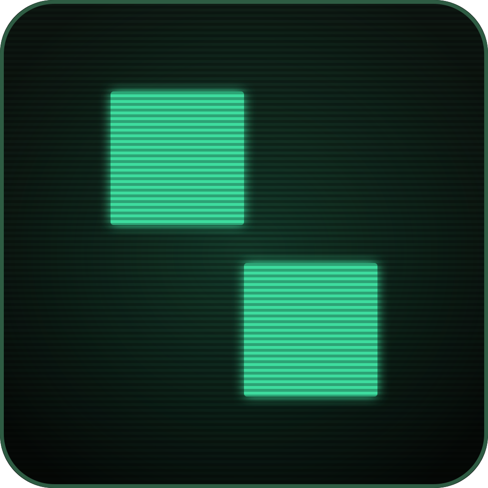

<p align="center">
  
</p>

<h1 align="center">Packall</h1>

<p align="center">
  A keyboard-driven catalogue of essential Linux software.<br>
  Browse 215 curated apps, queue a few, and let Packall install them with the right package manager for your distro.
</p>

<p align="center">
  
  
  
</p>

---

### Desktop app (GUI)

```bash
curl -fsSL https://packall-website.pages.dev/install.sh | sh
```

### Terminal app (TUI)

```bash
curl -fsSL https://packall-website.pages.dev/install.sh | sh -s -- --tui
```

Or build from source (Go 1.24+):

```bash
git clone https://github.com/nishu-murmu/packall.git && cd packall
go build -o packall ./cmd/packall && ./packall
```

Manual downloads are on the [Releases](https://github.com/nishu-murmu/packall/releases) page (AppImage, TUI tarball).

---

## Keyboard shortcuts

| Key | Action |
|---|---|
| `/` | Search |
| `j` `k` `h` `l` | Navigate |
| `Space` | Toggle app in queue |
| `i` / `u` / `x` | Install / update / remove |
| `?` | Full keybindings help |

---

## Development

```bash
npm install && npm run dev:tauri    # desktop app (needs Rust + Tauri deps)
npm run web:dev                     # frontend only
go run ./cmd/packall                # TUI
```

```bash
npm run typecheck && npm test       # TypeScript + Vitest
npm run test:rust                   # cargo test
go test ./...                       # Go tests
```

See the [releases page](https://github.com/nishu-murmu/packall/releases) for prebuilt binaries.

---

## Contributing

Bug fixes, distro support, and catalogue entries are welcome. Run the test suites before opening a PR.

To add an app, append an entry to [`src/lib/software.ts`](src/lib/software.ts) using the package names each distro actually ships.

---

## License

[AGPL-3.0](LICENSE)
